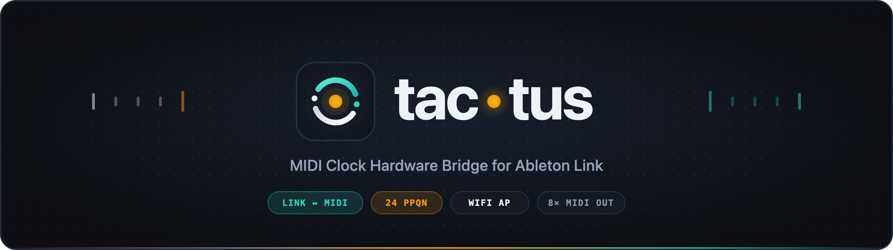
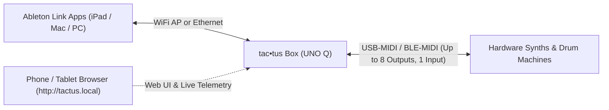
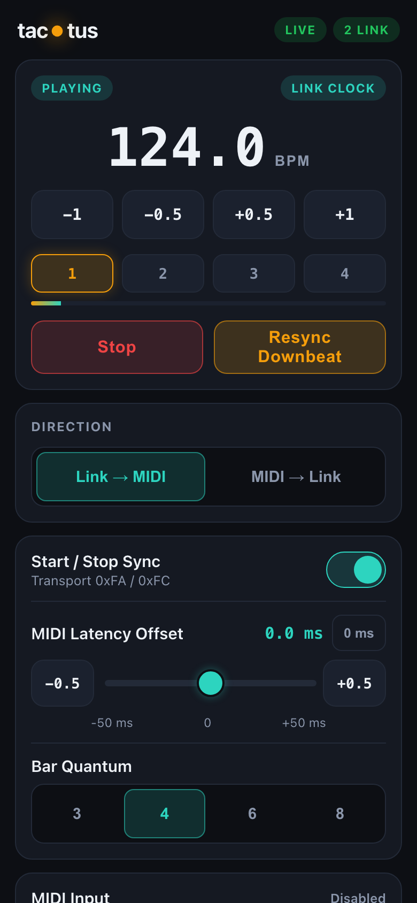
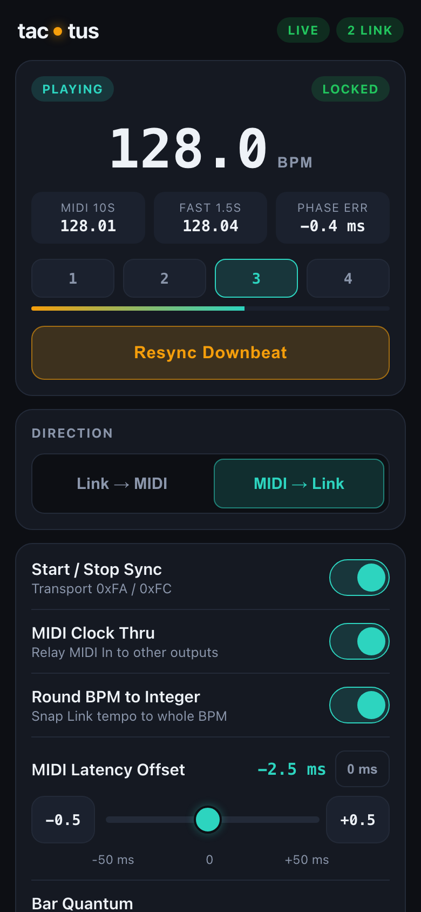
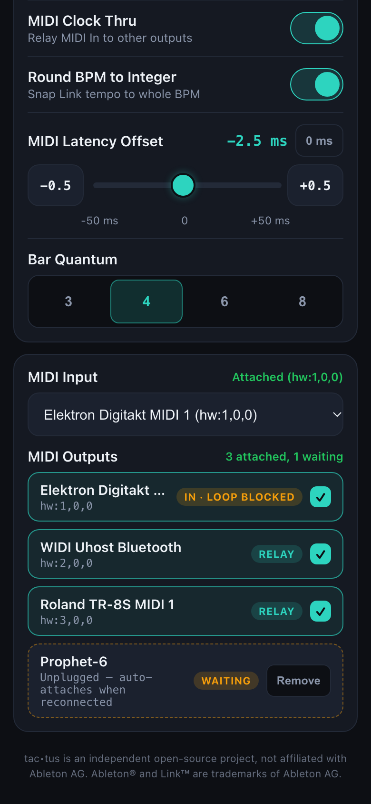

<p align="center">
  
</p>

**tac•tus** is a standalone hardware sync box that connects **Ableton Link** apps (on iPad, iPhone, Mac, or PC) with **USB-MIDI and BLE-MIDI hardware** (synthesizers, drum machines, sequencers, or USB BLE-MIDI adapters like the CME WIDI Uhost) over its own built-in WiFi Access Point — no computer or external router required.

- **Bidirectional Sync:** Run **Link → MIDI** (Ableton Link sets the tempo and drives your MIDI hardware) or **MIDI → Link** (a hardware drum machine or sequencer drives Ableton Link smoothly without tempo jitter).
- **Up to 8 MIDI Outputs + Hotplug:** Plug in USB-MIDI hubs or multiple instruments anytime; tac•tus remembers your selected ports, attaches them automatically, and can relay incoming MIDI clock (`MIDI Clock Thru`) with built-in loop protection.
- **Built-In WiFi Access Point:** Broadcasts the `Tactus` network (5 GHz channel `36` with automatic 2.4 GHz channel `11` fallback) without a captive portal, so your phone or iPad keeps using cellular data. Ethernet is also supported.
- **Mobile Web App:** Control tempo, direction, latency offset, and MIDI routing from any browser at `http://tactus.local`, or save it to your iOS/Android Home Screen as a fullscreen app.
- **At-a-Glance Hardware Feedback:** On the Arduino UNO Q, the onboard RGB `LED1` and optional 8×13 LED matrix + `LED3` show connection, sync direction, lock state, and beat/downbeat pulses.



---

## Quick Start (Arduino UNO Q)

### What You Need

- **Arduino UNO Q** (stock factory Debian works out of the box — Arduino App Lab is not required)
- **USB-C cable** to connect the UNO Q to your computer for initial setup
- **Class-compliant USB-MIDI or BLE-MIDI device** (e.g., CME WIDI Uhost, USB-MIDI interface, or USB-MIDI synth) and a powered USB-C host hub if connecting multiple devices
- **`adb`** on your computer for USB-C setup (or `ssh` if the board is already on Ethernet):
  - **macOS:** `brew install android-platform-tools`
  - **Debian / Ubuntu:** `sudo apt-get install -y adb`
  - **Windows:** `winget install Google.PlatformTools`

### Step 1: Install tac•tus (Offline Turnkey Installer)

Download `tactus-<version>-unoq-arm64.tar.gz` (macOS/Linux) or `tactus-<version>-unoq-arm64.zip` (Windows) from [GitHub Releases](https://github.com/manchoz/tactus/releases), extract it, connect your UNO Q via USB-C, and run the guided installer from the extracted folder:

```bash
# macOS / Linux
./install.sh
```

```powershell
# Windows (PowerShell)
.\install.ps1
```

The installer detects your board over USB-C (or prompts for SSH), sets up your board password and SSH key on fresh boards, lets you customize the WiFi passphrase (default: `tactus-link`) and country code, installs `tactusd` + the MCU LED matrix firmware + the 5 GHz WiFi AP kernel (with automatic boot fallback), and offers to reboot.

See [system/release/INSTALL.md](system/release/INSTALL.md) for unattended/advanced flags (`--yes`, `--psk`, `--country`, `--skip-kernel`, `--skip-mcu`, `--rollback-ap`).

### Step 2: Connect MIDI Gear & Join the `Tactus` Network

1. Plug your USB-MIDI interface, synth, or BLE-MIDI host adapter into the UNO Q USB host port (tac•tus detects class-compliant MIDI devices automatically).
2. On your phone, tablet, or computer, join the **`Tactus`** WiFi network using your passphrase (default: **`tactus-link`**).
   - *Tip:* The `Tactus` network does not intercept internet traffic, so iOS and Android keep cellular data active while connected. You can also connect via Ethernet on your local network.

### Step 3: Open the Web Interface

Open **`http://tactus.local`** (or **`http://10.42.0.1`**) in your browser.

- **iOS Home Screen App:** In Safari, tap **Share → Add to Home Screen** to launch tac•tus as a fullscreen app with automatic reconnect when you wake your phone.

---

## Using the Web Interface

<table>
  <tr>
    <td align="center"></td>
    <td align="center"></td>
    <td align="center"></td>
  </tr>
  <tr>
    <td align="center"><sub><strong>Link &rarr; MIDI</strong><br>Tempo nudge, beat strip &amp; transport</sub></td>
    <td align="center"><sub><strong>MIDI &rarr; Link</strong><br>Lock state, diagnostics &amp; Clock Thru</sub></td>
    <td align="center"><sub><strong>Parameters &amp; MIDI Ports</strong><br>Latency offset, fan-out &amp; loop guard</sub></td>
  </tr>
</table>

### Top Status Bar

- **Connection Pill:** Shows `LIVE` when connected to the box, `RECONNECTING` while recovering, or `OFFLINE` if unreachable.
- **Link Counter (`N LINK`):** Shows how many Ableton Link apps are currently active on the network.

### Tempo, Beat Strip & Transport

- **Status Badges:** Shows `PLAYING` or `STOPPED`, plus the sync state:
  - In **Link → MIDI:** `LINK CLOCK`
  - In **MIDI → Link:** `UNLOCKED` (waiting for incoming MIDI clock), `ACQUIRING` (measuring incoming tempo), or `LOCKED` (tracking hardware tempo and phase)
- **BPM & Nudge:**
  - In **Link → MIDI:** Tap the BPM readout to type an exact tempo (`20.0–300.0`, `0.1` BPM steps), or use **`-1`**, **`-0.5`**, **`+0.5`**, and **`+1`** to nudge tempo live.
  - In **MIDI → Link:** The BPM readout follows your hardware clock and displays live tracking diagnostics underneath (**`MIDI 10s`** long window average, **`Fast 1.5s`** step-change tracker, and **`Phase Err`** in milliseconds).
- **Beat Strip & Phase Bar:** Displays beats `1..N` (matching your Bar Quantum, highlighting beat `1` as the downbeat) alongside a smooth real-time progress bar.
- **`Play` / `Stop`:** Starts or stops the Ableton Link transport (and sends MIDI Start/Stop when `Start / Stop Sync` is enabled).
- **`Resync Downbeat`:** Quantizes a clean restart/alignment on the next bar downbeat.

### Sync Direction

- **`Link → MIDI`:** Ableton Link apps set the tempo and transport; tac•tus generates steady 24 PPQN MIDI Clock (`0xF8`) for your hardware.
- **`MIDI → Link`:** Incoming MIDI Clock from your selected `MIDI Input` drives Ableton Link. tac•tus smooths hardware jitter over a dual-window tracker, detects deliberate tempo changes automatically, nudges phase gently (`≤ 1 ms` per beat), and returns to `UNLOCKED` if clock stops for `500 ms`.

### Sync Parameters

- **`Start / Stop Sync`:** When on, MIDI Start (`0xFA`) and Stop (`0xFC`) follow transport state. Turn off to send/track continuous `0xF8` MIDI Clock only.
- **`MIDI Clock Thru`** *(shown in `MIDI → Link`)*: Relays incoming MIDI clock and transport directly to your selected MIDI outputs so secondary hardware stays tight with your master clock. tac•tus automatically blocks feedback loops back to the active input port.
- **`Round BPM to Integer`** *(shown in `MIDI → Link`)*: Snaps the tempo committed to Ableton Link to the nearest whole BPM (for example `120.0`) while keeping the unrounded measurement visible in diagnostics.
- **`MIDI Latency Offset`:** Shifts MIDI timing between **`-50.0 ms`** and **`+50.0 ms`** (`0.5 ms` steps, plus a **`0 ms`** reset button) to compensate for audio interface or synth latency in either direction.
- **`Bar Quantum`:** Choose **`3`**, **`4`**, **`6`**, or **`8`** beats per bar for downbeat alignment and visual beat strips.

### MIDI Ports

- **`MIDI Input`:** Select the single hardware port tac•tus listens to in `MIDI → Link` mode.
- **`MIDI Outputs`:** Toggle up to **8** simultaneous MIDI output ports. Each row shows a live status tag (`Active`, `Relay`, `Idle`, `IN · loop blocked`, `Attaching`, `Max 8`, or `Waiting` when unplugged).
- **Hotplug & Remembered Rules:** Unplugged devices stay remembered so they re-attach automatically when reconnected, or you can click **`Remove`** to forget an unplugged port.

### Typical Setups

1. **Hardware Synths Following Ableton Live / iPad (`Link → MIDI`):**
   - Set Sync Direction to **`Link → MIDI`**.
   - Enable the synths or interfaces you want to clock under **`MIDI Outputs`**.
   - Open your Ableton Link app on the `Tactus` WiFi network — its tempo and Play/Stop state now drive your hardware. Adjust **`MIDI Latency Offset`** if your audio path feels slightly early or late.
2. **Ableton Live / iPad + Secondary Gear Following a Hardware Drum Machine (`MIDI → Link`):**
   - Set Sync Direction to **`MIDI → Link`**.
   - Choose your drum machine under **`MIDI Input`**.
   - Enable **`MIDI Clock Thru`** and select any additional synths under **`MIDI Outputs`** (even if your drum machine appears as both input and output, tac•tus blocks the loopback automatically).
   - Press Play on your drum machine — once the badge reads **`LOCKED`**, your Link apps and secondary synths lock to the groove.

---

## Hardware Status Indicators (Arduino UNO Q)

### Onboard `LED1` (System & Sync Status)

| `LED1` Pattern | Meaning |
| :--- | :--- |
| **Blinking Blue** | Booting or waiting for the `Tactus` WiFi Access Point |
| **Solid Blue** | WiFi AP ready, idle (no Link peers and no MIDI ports attached) |
| **Solid Yellow** | MIDI device(s) attached, no Ableton Link peers connected |
| **Solid Green** | Ableton Link peer(s) connected, no MIDI device attached |
| **Solid Cyan** | Both Ableton Link peer(s) and MIDI device(s) active |
| **Fast Blinking Red** | System fault detected on the board |

### Optional 8×13 LED Matrix & `LED3` (MCU Companion)

Installed automatically by the turnkey installer (unless `--skip-mcu` is passed). See [mcu/tactus-zephyr/README.md](mcu/tactus-zephyr/README.md) for the full pixel coordinate legend.

| Indicator | Meaning |
| :--- | :--- |
| **Standby (breathing 3-pixel bar + blue `LED3`)** | Waiting for `tactusd` connection |
| **Center Arrow (`->` / `<-`)** | Sync direction (`->` for `Link → MIDI`, `<-` for `MIDI → Link`) |
| **Bottom Strip (Left / Right)** | Left side = Lock / Ready state; Right side = Play / Stop state |
| **Full Border Flash + Warm Gold/White `LED3`** | Beat `1` bar downbeat (`180 ms` decay) |
| **4-Corner Pulse + Cyan/Emerald/Amber `LED3`** | Beats `2..N` (`120 ms` pulse) |

---

## Troubleshooting

- **WiFi AP stays on 2.4 GHz after installing:** Reboot the UNO Q so the custom 5 GHz kernel (`7.2.11-arduino1-tactus+`) takes effect. If the custom kernel ever fails to boot twice, `systemd-boot` automatically rolls back to the stock kernel and 2.4 GHz channel `11` fallback.
- **USB-MIDI device is not detected:** Confirm the device is class-compliant USB-MIDI and connected to the UNO Q USB host port (use a powered USB-C hub if the device draws significant bus power).
- **Cannot reach `http://tactus.local`:** Make sure your device is joined to the `Tactus` WiFi network (or same Ethernet LAN), or open **`http://10.42.0.1`** directly.
- **Restore normal WiFi client mode (`wlan0`):** Run `./install.sh --rollback-ap` (macOS/Linux) or `.\install.ps1 -RollbackAp` (Windows) from the release package folder.
- **Fast blinking red `LED1`:** Power-cycle the board; if it persists, inspect service logs over SSH as described in [DEVELOPMENT.md](DEVELOPMENT.md).
- **Settings persistence:** All Web UI changes (direction, offsets, quantum, MIDI port rules) are saved automatically to `/var/lib/tactus/config.toml` across reboots (schema in [SPEC.md §5](SPEC.md#L65-L93)).

---

## For Developers & Documentation

- [DEVELOPMENT.md](DEVELOPMENT.md) — Architecture, workspace layout, Rust/ARM64 build & test setup, Yocto `abl_link` overrides, from-source UNO Q provisioning, and Bonjour/SSH diagnostics
- [SPEC.md](SPEC.md) — Bidirectional sync algorithm, network, Web UI, and `config.toml` specifications
- [ARCHITECTURE.md](ARCHITECTURE.md) — Threading model, RT/async protocol contract, and boot sequence
- [MILESTONES.md](MILESTONES.md) — Phased execution and verification plan
- [AGENTS.md](AGENTS.md) — Non-negotiable architectural invariants and verification gates
- `arduino-router` crate — [GitHub (`manchoz/arduino-router-rs`)](https://github.com/manchoz/arduino-router-rs) · [crates.io](https://crates.io/crates/arduino-router) · [docs.rs](https://docs.rs/arduino-router)

## License

tac•tus original source code is licensed under the **Mozilla Public License 2.0 (`MPL-2.0`)** without Exhibit B incompatibility — see [LICENSE](LICENSE) and [Cargo.toml](Cargo.toml).

tac•tus links against official [`Ableton/link`](vendor/ableton-link/LICENSE.md), which is licensed under **`GPL-2.0-or-later`** (with a commercial licensing option from Ableton AG). Under MPL-2.0 §3.3 (*Larger Work*), compiled `tactusd` binaries and appliance images incorporating open-source `Ableton/link` are distributed under **`GPL-2.0-or-later`**, while tac•tus's own source files remain available under `MPL-2.0`.

## Trademarks & Disclaimer

**tac•tus** is an independent open-source project and is not affiliated, associated, authorized, endorsed by, or in any way officially connected with **Ableton AG** (<https://www.ableton.com>) or any of its subsidiaries or affiliates.

**Ableton®** and **Link™** (*Ableton Link*) are trademarks of Ableton AG. All other product names, logos, and brands mentioned in this repository—including **Arduino®**, **MIDI®**, **Apple®**, **iPad®**, **iPhone®**, **iOS**, **macOS®**, **Safari®**, **Bonjour®**, **Android™**, and **CME WIDI**—are the property of their respective owners and are used solely to identify technical compatibility.
